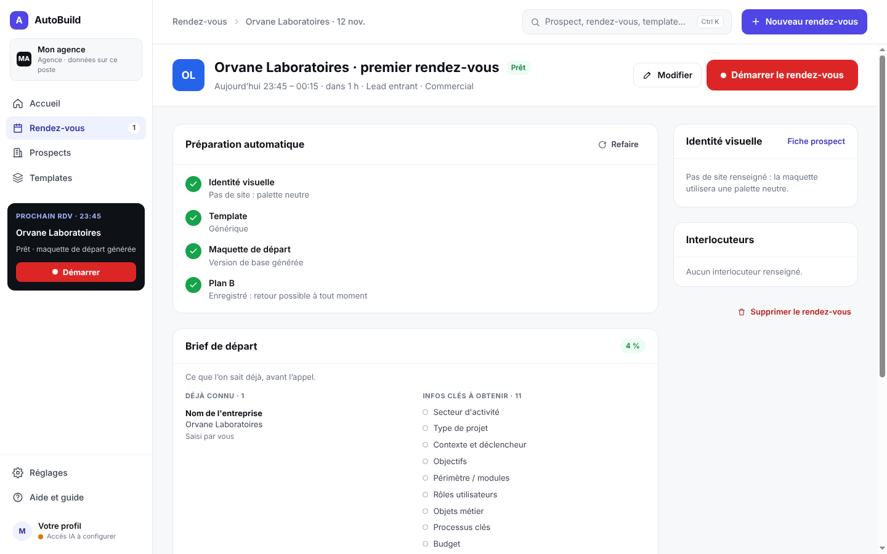
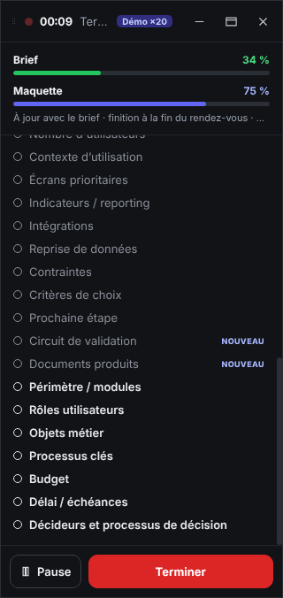
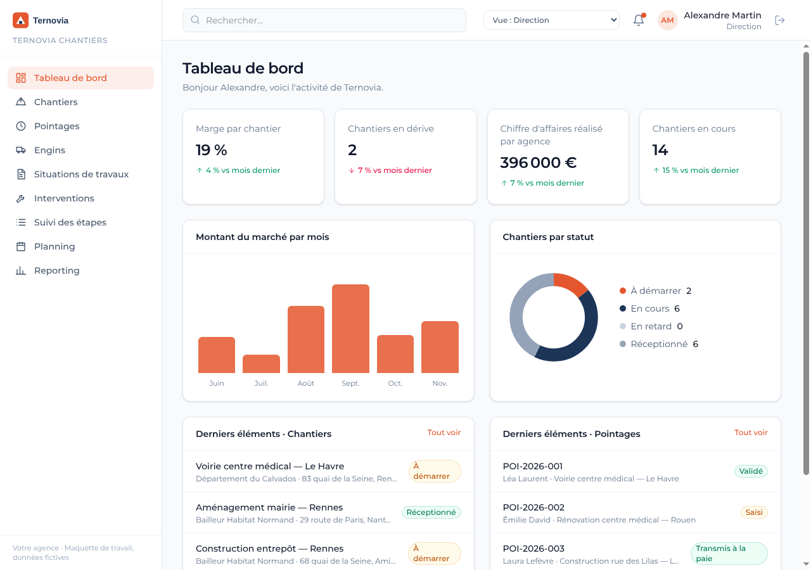
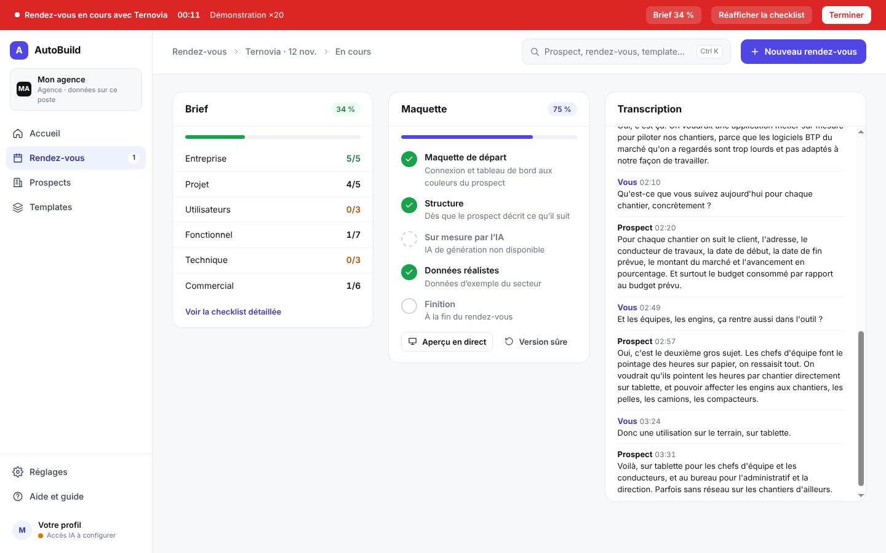
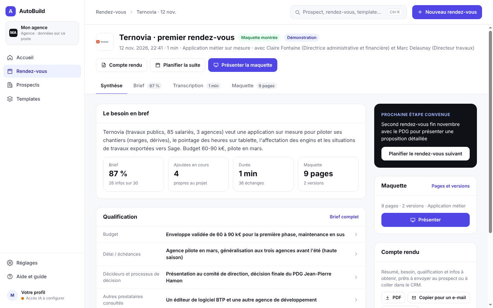
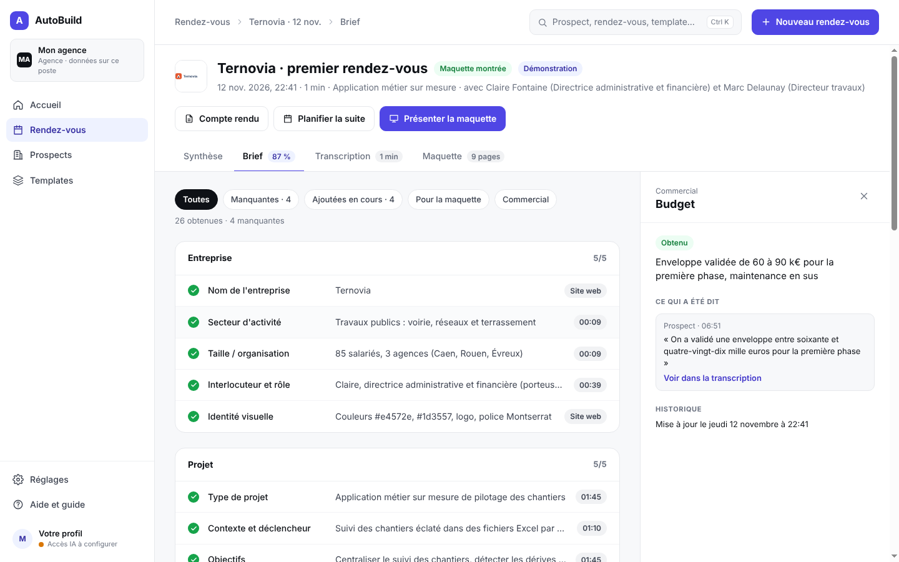

# AutoBuild

> **Votre prospect vous parle de son projet, vous lui montrez la maquette avant de raccrocher.**

Application desktop (macOS et Windows) pour les agences de développement et ESN qui vendent du sur-mesure
(intranet, extranet, ERP, applications métier). Pendant le premier rendez-vous en visio :

1. **Avant** : le rendez-vous est créé à l'avance (prospect, site web, créneau) ; AutoBuild récupère l'identité
   visuelle du prospect et prépare une maquette de départ dans le bon template.
2. **Pendant** : l'interface se retire. Un **widget** reste par-dessus la visio (invisible en partage d'écran) :
   infos obtenues en vert, infos à obtenir en bas, avancement du brief et de la maquette. AutoBuild écoute sans bot
   (micro = le commercial, son de l'ordinateur = le prospect), transcrit (Gemini), remplit le **brief** avec une
   citation exacte pour chaque info (Claude ou Gemini), et l'IA **code la maquette** à partir du template.
3. **Fin** : la maquette s'ouvre en plein écran, aux couleurs du prospect, avec ses objets métier et ses mots.
4. **Après** : chaque rendez-vous garde sa synthèse, son brief, sa transcription, sa maquette (et ses versions) et
   son compte rendu ; le rendez-vous suivant reprend la maquette.

| Préparation | Widget pendant l'appel | Maquette en fin d'appel |
|---|---|---|
|  |  |  |

| Interface pendant l'appel | Rendez-vous passé | Brief et preuves |
|---|---|---|
|  |  |  |

---

## Démarrer

Prérequis pour le développement : **Node.js 22** et npm.

```bash
npm run setup      # installe l'application + les dépendances du template « socle »
npm run dev        # lance l'application
```

**Sans clé API**, cliquez sur **« Lancer la démonstration »** : un faux rendez-vous (entreprise fictive de travaux
publics) est créé, préparé, puis rejoué en accéléré ; le widget, le brief et la maquette se construisent comme en vrai
(maquette « de base », sans IA de génération).

**Pour un vrai rendez-vous**, ouvrez **Réglages › Accès IA** :

| Accès | Sert à | Sans lui |
|---|---|---|
| Clé Gemini (Google AI Studio) | transcription en direct ; brief en option | pas de transcription |
| Claude : **clé API Anthropic** *ou* **Claude Code installé** (votre abonnement) | brief ; génération sur mesure de la maquette | maquette de base uniquement |

Les clés sont chiffrées par le système (trousseau macOS / DPAPI Windows). En développement, les variables
`ANTHROPIC_API_KEY` et `GEMINI_API_KEY` sont aussi lues.

**Mode « Claude Code installé »** : AutoBuild lance le Claude Code officiel du poste en mode headless (`claude -p`),
qui utilise sa propre connexion (`claude` puis `/login`). AutoBuild ne lit, ne copie ni ne stocke aucun identifiant.
Ce mode sert à **tester sur son propre poste** ; pour un produit distribué à des clients, Anthropic demande
l'authentification par clé API ([conditions](https://code.claude.com/docs/en/legal-and-compliance)).

### Installeurs Mac et Windows

Les installeurs prêts à tester sont publiés dans les **Releases** du dépôt (pré-versions « version de test ») :
`AutoBuild-Setup-x.y.z.exe` (Windows), `AutoBuild-x.y.z-arm64.dmg` (Mac Apple Silicon), `AutoBuild-x.y.z-x64.dmg`
(Mac Intel). Guide d'installation et de test : [docs/notes-version.md](docs/notes-version.md).

Pour en produire de nouveaux : onglet **Actions** → « Tests et installeurs » → *Run workflow* (ou pousser un tag `v*`).
En local : `npm run dist:mac` (sur un Mac) ou `npm run dist:win` (sur un PC Windows).

---

## Un rendez-vous, de bout en bout

1. **Nouveau rendez-vous** (en haut à droite) : entreprise, site web, créneau, lien de la visio, interlocuteurs,
   contexte, notes. La **préparation** démarre aussitôt : identité visuelle, template, maquette de départ, plan B.
2. **Démarrer le rendez-vous** (accueil, carte « Prochain RDV » ou page du rendez-vous) : la fenêtre de lancement
   vérifie en direct votre micro et le son de la visio ; cochez l'accord du prospect, *Lancer l'enregistrement*.
3. **Pendant l'appel**, seul le widget reste à l'écran : regardez le bas de la liste (ce qui manque). Boutons :
   réduire en pastille, revenir à l'interface (bandeau rouge, brief/maquette/transcription en direct), fermer
   (l'enregistrement continue), pause. Raccourci **Ctrl/⌘ + Alt + C**.
4. **Terminer** → la maquette est finalisée puis s'ouvre en plein écran : partagez cette fenêtre.
5. **Après** : page du rendez-vous → *Synthèse* (besoin, qualification, à creuser, compte rendu PDF / e-mail /
   Markdown), *Brief* (chaque info avec son passage de transcription), *Transcription*, *Maquette* (pages, versions,
   restauration) ; *Planifier la suite* reprend la maquette et le brief.

Utilisez un **casque** : sinon le micro capte aussi la voix du prospect. Les maquettes sont des projets Vite + React
modifiables, dans `Documents/AutoBuild/maquettes/`.

---

## Comment ça marche

```
 Micro (commercial) ─┐
                     ├─► découpage sur les silences ─► Gemini (transcription) ─► transcript horodaté
 Audio système ──────┘        (renderer, 16 kHz)          (main, par tronçons      S1, S2… commercial / prospect
 (prospect)                                                 ou flux Live)                  │
                                                                                           ▼
                        brief.json ◄── vérification des citations ◄── Claude ou Gemini (toutes les 25 s)
                            │                                          sorties structurées
             ┌──────────────┼──────────────────────┐
             ▼              ▼                      ▼
     widget (par-dessus  générateur de base    agent Claude (Agent SDK) ─► modifie le code du template
     la visio)           (app.json, sans IA)        │                         dans l'espace de travail
                             │                      ▼
                             └──────────► compilation TypeScript : OK → instantané ; échec → retour arrière
                                                    │
                                                    ▼
                                    preview Vite locale (rechargement à chaud) ─► fenêtre partagée au prospect
```

Détails et choix techniques : [docs/architecture.md](docs/architecture.md).

| Document | Contenu |
|---|---|
| [docs/projet.md](docs/projet.md) | Cahier des charges initial et décisions validées |
| [docs/architecture.md](docs/architecture.md) | Flux, choix techniques, garde-fous, coûts, limites connues |
| [docs/grille-qualification.md](docs/grille-qualification.md) | Les 26 informations de la grille commune |
| [docs/catalogue-projets.md](docs/catalogue-projets.md) | Types de projets d'une agence (dont imagile.fr) et feuille de route des templates |
| [docs/templates.md](docs/templates.md) | Les 4 templates intégrés, la bibliothèque de pages, créer ou brancher un template (contrat pour les agences) |
| [docs/tests-terrain.md](docs/tests-terrain.md) | Ce qui est testé, ce qui reste à tester sur Mac/Windows, protocole des 3 faux rendez-vous |

## Structure du dépôt

```
src/shared/      logique pure (testée) : brief, grille, preuves, catalogue, découpage audio, générateur de base
src/main/        processus principal Electron : données du poste, moteur des rendez-vous, transcription Gemini,
                 brief Claude/Gemini, extraction de marque, générateur (espace de travail, versions, agent, preview)
src/renderer/    interface : écrans (accueil, rendez-vous, prospects, templates, réglages), widget, capture audio
templates/socle/ projet Vite + React + Tailwind piloté par app.json : kit d'interface, bibliothèque de 12 pages,
                 CLAUDE.md pour l'agent
templates/erp, app-metier, extranet, intranet/   templates intégrés (manifestes qui étendent le socle)
scenarios/       faux rendez-vous rejouables (transcript + site web fictif + patchs de brief)
scripts/         démo sans interface, tests de bout en bout de l'application et de la chaîne audio
```

## Tests

```bash
npm test                 # tests unitaires et d'intégration (brief, preuves, audio, générateur, garde-fous)
npm run typecheck        # TypeScript : application + template
npm run demo:headless    # pipeline complet sans interface : scénario → brief → maquette → compilation
npm run test:app         # application Electron pilotée (xvfb-run sous Linux) avec captures d'écran
npm run test:audio       # chaîne audio réelle avec le micro factice de Chromium
```

## État

Fonctionne et testé : parcours complet en démonstration (création, préparation, widget, fin, présentation,
rendez-vous passé), 4 templates et leur bibliothèque de pages, extraction de marque, générateur de base, garde-fou de
compilation et versions, chaîne audio (micro + son de l'ordinateur) jusqu'à l'envoi des tronçons. **À valider sur vos
machines** : capture de l'audio système sur macOS et Windows, widget au-dessus d'une visio plein écran, appels réels à
Gemini et Claude, temps et coût de génération. Voir [docs/tests-terrain.md](docs/tests-terrain.md).

Prochaines étapes : templates CRM, planning/interventions, mobile terrain, configurateur ; synchronisation de l'agenda
et des données entre les postes de l'agence.
