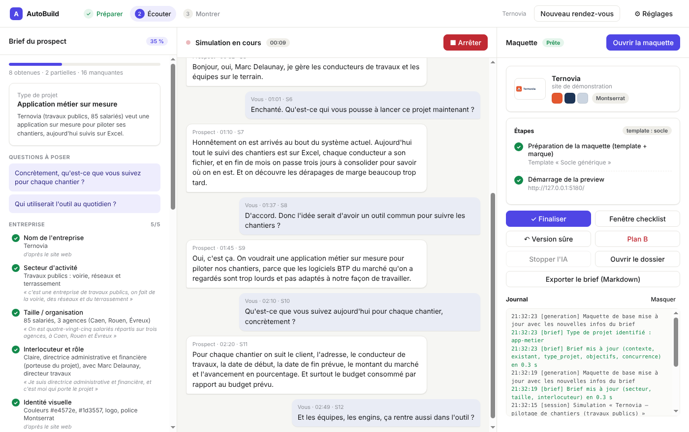
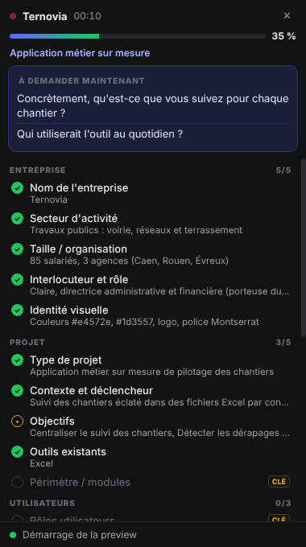

# AutoBuild

> **Votre prospect vous parle de son projet, vous lui montrez la maquette avant de raccrocher.**

Application desktop (macOS et Windows) pour les agences de développement et ESN qui vendent du sur-mesure
(intranet, extranet, ERP, applications métier). Pendant le premier rendez-vous en visio :

1. **Écoute** la visio sans bot : micro = le commercial, audio système = le prospect, transcription en direct (Gemini).
2. **Checklist flottante** de qualification, mise à jour en continu, invisible au partage d'écran.
3. **Brief structuré** rempli par l'IA (Claude ou Gemini), avec une citation exacte pour chaque info : rien n'est deviné.
4. **Choix du template** selon le type de projet identifié.
5. **Maquette sur mesure** construite pendant l'appel : identité visuelle du prospect (logo, couleurs, police, textes
   de son site), ses objets métier, ses champs, ses rôles, des données fictives réalistes. L'IA (Claude) modifie
   le code du template en tâche de fond ; à la fin des 30 minutes, le commercial partage la fenêtre de la maquette.

| Pendant l'appel | Checklist flottante | Maquette générée (scénario de démo) |
|---|---|---|
|  |  |  |

---

## Démarrer

Prérequis pour le développement : **Node.js 22** et npm.

```bash
npm run setup      # installe l'application + les dépendances du template « socle »
npm run dev        # lance l'application
```

**Sans clé API**, cliquez sur **« Lancer la démo »** : un faux rendez-vous (entreprise fictive de travaux publics) est
rejoué, et la transcription, le brief, la checklist et la maquette se construisent comme en vrai (maquette « de base »,
sans IA de génération).

**Pour un vrai rendez-vous**, ouvrez **Réglages** :

| Accès | Sert à | Sans lui |
|---|---|---|
| Clé Gemini (Google AI Studio) | transcription en direct ; brief en option | pas de transcription |
| Claude : **clé API Anthropic** *ou* **Claude Code installé** (votre abonnement) | brief ; génération sur mesure de la maquette | maquette de base uniquement |

Les clés sont chiffrées par le système (trousseau macOS / DPAPI Windows). En développement, les variables
`ANTHROPIC_API_KEY` et `GEMINI_API_KEY` sont aussi lues.

**Mode « Claude Code installé »** : AutoBuild lance le Claude Code officiel du poste en mode headless (`claude -p`),
qui utilise sa propre connexion (`claude` puis `/login`). AutoBuild ne lit, ne copie ni ne stocke aucun identifiant.
Ce mode sert à **tester sur son propre poste** ; pour un produit distribué à des clients, Anthropic demande
l'authentification par clé API ([conditions](https://code.claude.com/docs/en/legal-and-compliance)).

### Installeurs Mac et Windows

Les installeurs prêts à tester sont publiés dans les **Releases** du dépôt (pré-versions « version de test ») :
`AutoBuild-Setup-x.y.z.exe` (Windows), `AutoBuild-x.y.z-arm64.dmg` (Mac Apple Silicon), `AutoBuild-x.y.z-x64.dmg`
(Mac Intel). Guide d'installation et de test : [docs/notes-version.md](docs/notes-version.md).

Pour en produire de nouveaux : onglet **Actions** → « Tests et installeurs » → *Run workflow* (ou pousser un tag `v*`).
En local : `npm run dist:mac` (sur un Mac) ou `npm run dist:win` (sur un PC Windows).

---

## Pendant un rendez-vous

1. **Préparer** (quelques minutes avant) : nom de l'entreprise + site web → identité visuelle extraite, maquette de
   départ générée, preview lancée, **plan B** enregistré.
2. **Écouter** : cochez l'information RGPD (prospect prévenu), *Démarrer l'écoute*, ouvrez la **fenêtre checklist**.
   Suivez les **questions suggérées** pour combler les trous du brief. Un champ peut être saisi ou corrigé à la main
   (cliquer dessus) : une saisie manuelle n'est jamais écrasée par l'IA.
3. **Montrer** : *Finaliser* → dernière passe de l'IA et vérification → *Ouvrir la maquette* → partagez cette fenêtre.
   En cas de souci : **Version sûre** (dernière version qui compile) ou **Plan B**.
4. Après l'appel : *Exporter le brief* (Markdown, avec la transcription) ; la maquette reste dans
   `Documents/AutoBuild/maquettes/` (projet Vite + React modifiable).

Utilisez un **casque** : sinon le micro capte aussi la voix du prospect.

---

## Comment ça marche

```
 Micro (commercial) ─┐
                     ├─► découpage sur les silences ─► Gemini (transcription) ─► transcript horodaté
 Audio système ──────┘        (renderer, 16 kHz)          (main, par tronçons      S1, S2… commercial / prospect
 (prospect)                                                 ou flux Live)                  │
                                                                                           ▼
                        brief.json ◄── vérification des citations ◄── Claude ou Gemini (toutes les 25 s)
                            │                                          sorties structurées
             ┌──────────────┼──────────────────────┐
             ▼              ▼                      ▼
     fenêtre checklist   générateur de base    agent Claude (Agent SDK) ─► modifie le code du template
     (flottante)         (app.json, sans IA)        │                         dans l'espace de travail
                             │                      ▼
                             └──────────► compilation TypeScript : OK → instantané ; échec → retour arrière
                                                    │
                                                    ▼
                                    preview Vite locale (rechargement à chaud) ─► fenêtre partagée au prospect
```

Détails et choix techniques : [docs/architecture.md](docs/architecture.md).

| Document | Contenu |
|---|---|
| [docs/projet.md](docs/projet.md) | Cahier des charges initial et décisions validées |
| [docs/architecture.md](docs/architecture.md) | Flux, choix techniques, garde-fous, coûts, limites connues |
| [docs/grille-qualification.md](docs/grille-qualification.md) | Les 26 informations du brief et les questions associées |
| [docs/catalogue-projets.md](docs/catalogue-projets.md) | Types de projets d'une agence (dont imagile.fr) et feuille de route des templates |
| [docs/templates.md](docs/templates.md) | Créer ou brancher un template (contrat pour les agences) |
| [docs/tests-terrain.md](docs/tests-terrain.md) | Ce qui est testé, ce qui reste à tester sur Mac/Windows, protocole des 3 faux rendez-vous |

## Structure du dépôt

```
src/shared/      logique pure (testée) : brief, grille, preuves, catalogue, découpage audio, générateur de base
src/main/        processus principal Electron : session, transcription Gemini, brief Claude/Gemini,
                 extraction de marque, générateur (espace de travail, instantanés, agent, preview)
src/renderer/    interface : fenêtre principale, fenêtre checklist, capture audio
templates/socle/ template générique Vite + React + Tailwind piloté par app.json (+ CLAUDE.md pour l'agent)
scenarios/       faux rendez-vous rejouables (transcript + site web fictif + patchs de brief)
scripts/         démo sans interface, tests de bout en bout de l'application et de la chaîne audio
```

## Tests

```bash
npm test                 # tests unitaires et d'intégration (brief, preuves, audio, générateur, garde-fous)
npm run typecheck        # TypeScript : application + template
npm run demo:headless    # pipeline complet sans interface : scénario → brief → maquette → compilation
npm run test:app         # application Electron pilotée (xvfb-run sous Linux) avec captures d'écran
npm run test:audio       # chaîne audio réelle avec le micro factice de Chromium
```

## État du MVP

Fonctionne et testé : pipeline complet en mode démo, interface, checklist, extraction de marque, générateur de base,
garde-fou de compilation et retour arrière, chaîne audio (micro + loopback) jusqu'à l'envoi des tronçons,
application packagée (Linux). **À valider sur vos machines** (impossible depuis l'environnement de développement) :
capture de l'audio système sur macOS et Windows, appels réels à Gemini et Claude, temps et coût réels de génération.
Voir [docs/tests-terrain.md](docs/tests-terrain.md).

Reste à faire : **les templates métier** (ERP, CRM, intranet, extranet, app métier…), voir
[docs/catalogue-projets.md](docs/catalogue-projets.md).
